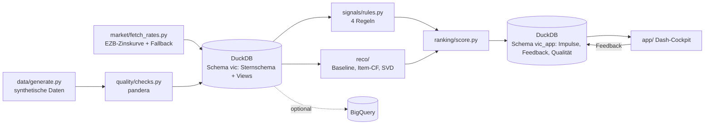

# Vertriebsimpuls-Cockpit

[](https://github.com/alfredlog/vertriebsimpuls-cockpit/actions/workflows/ci.yml)

> Unabhängiges privates Projekt, keine Verbindung zu einer Bank, alle Daten fiktiv.

Kundenbetreuer im Kapitalmarktvertrieb (Genossenschaftsbanken, Drittbanken, Firmenkunden,
Institutionelle) haben täglich mehr mögliche Gesprächsanlässe, als sie bearbeiten können:
Fälligkeiten, Zinsbewegungen, inaktive Kunden, einseitige Portfolios. Das Cockpit berechnet jeden
Morgen je Betreuer eine priorisierte Liste von **Vertriebsimpulsen** (Kunde → Produkt → Begründung →
Score). Geschäftsregeln erklären, *warum jetzt*; ein Empfehlungsmodell schlägt vor, *welches Produkt*.
Jede Begründung nennt die konkreten Fakten (Datum, Betrag, Basispunkte).

**Demo:** _Link folgt_

## Screenshots

`docs/img/` ist noch leer; es gibt noch keine Screenshots. Erzeugen bei laufender App
(siehe [Schnellstart](#schnellstart)), z. B. mit Chrome im Headless-Modus:

```bash
"/Applications/Google Chrome.app/Contents/MacOS/Google Chrome" --headless=new --hide-scrollbars --window-size=1440,1500 --virtual-time-budget=10000 --screenshot=docs/img/tagesimpulse.png http://127.0.0.1:8050/
```

## Architektur



Der Tageslauf `vic.pipeline.daily_run` verbindet die Schritte: Daten erzeugen → Qualitätsprüfung
(Abbruch bei Fehlern, die Datenbank des Vortags bleibt unverändert) → Laden → Signale →
Empfehlungen → Ranking → Impulse schreiben. Jeder Schritt wird mit Laufzeit geloggt.

| Modul | Aufgabe |
|---|---|
| `src/vic/data/generate.py` | Reproduzierbare synthetische Daten aus einem Seed (Betreuer, Produkte, Kunden, Geschäfte, Positionen) |
| `src/vic/db.py` | Einziger Zugang zu DuckDB: Schema anlegen, transaktionales Neuladen, `query_df` |
| `src/vic/sql/` | Sternschema, Feature-Views, App-Schema, BigQuery-Beispielabfragen |
| `src/vic/market/` | AAA-Zinsstrukturkurve der EZB (Kassazinsen 1–30 J.), Fallback-CSV bei Netzfehlern |
| `src/vic/signals/` | Geschäftsregeln mit Begründung und Fakten |
| `src/vic/reco/` | Interaktionsmatrix, drei Modelle, zeitliche Evaluation |
| `src/vic/ranking/` | Kombination von Regel- und Modell-Score, Top 10 je Betreuer |
| `src/vic/quality/` | pandera-Prüfungen auf Eingangsdaten und Impulsen |
| `src/vic/pipeline/` | Tageslauf (CLI) |
| `src/vic/bq.py` | Optionaler BigQuery-Export und Kostenschätzung |
| `app/` | Dash-Cockpit: Tagesimpulse, Kunde 360°, Markt-Monitor, Monitoring |

Entscheidungen: [ADR 0001 DuckDB und BigQuery](docs/adr/0001-duckdb-and-bigquery.md),
[ADR 0002 Empfehlungsmodelle](docs/adr/0002-recommender-choice.md),
[ADR 0003 Score-Gewichtung](docs/adr/0003-score-weighting.md),
[ADR 0004 Dash](docs/adr/0004-dash.md).

## Datenmodell

Sternschema im DuckDB-Schema `vic` (Stichtag `as_of` = 20.11.2026, Seed 42):

| Tabelle | Granularität (eine Zeile je …) | Zeilen |
|---|---|---:|
| `fact_trades` | Geschäft (Kunde, Produkt, Handelstag, Nominal) | 7.898 |
| `fact_positions` | offene Position zum Stichtag (Kunde, Produkt, Start, Fälligkeit, Nominal) | 7.036 |
| `market_rates` | Handelstag × Laufzeit (Kassazins in %) | 1.940 |
| `dim_client` | Kunde (Segment, Region, Vermögen, Risikoprofil, variable Finanzierung, Betreuer) | 300 |
| `dim_product` | Produkt (Assetklasse, Laufzeit, Risikostufe 1–5, Absicherungsprodukt) | 16 |
| `dim_sales_rep` | Betreuer | 8 |
| `dim_date` | Kalendertag (deckt alle Handelstage und den Stichtag ab) | 731 |

`vic.run_context` hält den Stichtag; alle Views rechnen damit, nie mit `CURRENT_DATE`.
Geldbeträge sind `DECIMAL(18,2)`, Segment/Assetklasse/Risikoprofil sind ENUMs, Fremdschlüssel werden
erzwungen. Das Schema `vic_app` (Tagesimpulse, Feedback, Qualitätsergebnisse) wird beim täglichen
Neuladen nicht gelöscht.

## Regeln (Signale)

| Signal | Auslöser | Vorschlag | Stärke |
|---|---|---|---|
| Fälligkeit | Position fällig in ≤ 30 Tagen | meistgehandeltes passendes Produkt derselben Assetklasse | linear von 1,0 (0 Tage) bis 0,5 (30 Tage) |
| Zinsbewegung | 5J- oder 10J-Zins ändert sich in 14 Tagen um mehr als 20 bp, Kunde mit variabler Finanzierung | steigend: Zinsswap 5J, fallend: Zinscap 3J | \|Δ\| / 40 bp, max. 1,0 |
| Reaktivierung | > 90 Tage kein Geschäft, aber Umsatz in den 90 Tagen davor | kein Produkt (kommt aus dem Modell) | linear von 1,0 (90 Tage) bis 0,5 (180 Tage) |
| Konzentration | eine Assetklasse > 60 % des Volumens der letzten 12 Monate | im Segment verbreitete (≥ 20 % der Kunden), beim Kunden fehlende Klasse; keine Absicherungsprodukte | 0,5 (60 %) bis 1,0 (100 %) |

Geeignetheit gilt für Regeln und Modell: Risikostufe ≤ 2 (konservativ), ≤ 3 (ausgewogen),
≤ 5 (dynamisch); Zinsabsicherungen nur bei variabler Finanzierung. Begründungen werden ausschließlich
aus den gespeicherten Fakten erzeugt; ein Test prüft, dass jede Zahl im Text in den Fakten steht.

Am 20.11.2026 ergeben die Regeln 197 Signale (118 Fälligkeit, 62 Konzentration, 17 Reaktivierung).
Zinsbewegungen lösen nicht aus: Die 5J-/10J-Zinsen haben sich in 14 Tagen nur um +8,4 bzw. +7,5 bp
bewegt.

## Empfehlungsmodell und Evaluation

Implizite Matrix Kunde × Produkt mit `log1p(Anzahl Geschäfte)`. Modelle: Segment-Popularität
(Baseline), Item-Item-CF (Kosinus-Ähnlichkeit, selbst implementiert) und TruncatedSVD. Zeitliche
Aufteilung: Training bis 21.08.2026, Test 22.08.–20.11.2026.

**Neue Produkte** (im Training nicht gehandelt; 72 Kunden bewertet, 228 ohne neues Produkt ausgeschlossen):

| Modell | P@3 | R@3 | NDCG@3 | P@5 | R@5 | NDCG@5 | Abdeckung@5 |
|---|---:|---:|---:|---:|---:|---:|---:|
| Baseline (Segment-Popularität) | 0,245 | 0,641 | 0,506 | 0,192 | 0,819 | 0,583 | 1,000 |
| Item-Item CF | 0,213 | 0,546 | 0,466 | 0,186 | 0,799 | 0,574 | 1,000 |
| Truncated SVD | 0,213 | 0,537 | 0,413 | 0,178 | 0,743 | 0,502 | 1,000 |

**Alle im Testfenster gehandelten Produkte** (255 Kunden bewertet, 45 ohne Geschäft ausgeschlossen):

| Modell | P@3 | R@3 | NDCG@3 | P@5 | R@5 | NDCG@5 | Abdeckung@5 |
|---|---:|---:|---:|---:|---:|---:|---:|
| Baseline (Segment-Popularität) | 0,352 | 0,436 | 0,438 | 0,292 | 0,597 | 0,494 | 0,688 |
| Item-Item CF | 0,241 | 0,274 | 0,283 | 0,223 | 0,444 | 0,347 | 0,875 |
| Truncated SVD | 0,366 | 0,453 | 0,461 | 0,322 | 0,658 | 0,541 | 0,938 |

Einordnung: Bei neuen Produkten schlägt keines der Modelle die Baseline; der Abstand von Item-CF liegt
im Rauschen (Bootstrap-95-%-Intervall der NDCG@5-Differenz enthält 0). Bei allen Produkten ist SVD
leicht besser als die Baseline (NDCG@5 +0,047). Ursache: Der Generator verteilt Kundenpräferenzen eng
um das Segmentprofil, die Segment-Popularität ist daher nahe am wahren Datenprozess. Mit 16 Produkten
ist die Abdeckung bei neuen Produkten trivial. Der Tageslauf nutzt automatisch das Modell mit der besten
NDCG@5 auf neuen Produkten, derzeit die Baseline. Details: [docs/evaluation.md](docs/evaluation.md).

## Ranking

`Score = 0,7 · Signalstärke + 0,3 · normierter Modell-Score (+ 0,1, wenn Regel und Modell dasselbe
Produkt nennen)`, Top 10 je Betreuer, eine Zeile je Kunde und Produkt mit der Begründung des stärksten
Signals. Nur-Modell-Impulse tragen die Begründung „Kunden mit ähnlichem Profil handeln <Produkt>“.
Jede Regel (mind. 0,35) liegt damit vor jeder reinen Empfehlung (max. 0,30); Begründung in ADR 0003.
Am 20.11.2026: 80 Impulse für 8 Betreuer (39 Konzentration, 27 Fälligkeit, 14 Reaktivierung).

## Monitoring und Datenqualität

- **Monitoring-Seite:** Annahmequote je Signaltyp und Woche (aus dem Feedback „angenommen“/
  „abgelehnt“), NDCG@5 der Modelle je Evaluationslauf (`vic.reco_eval_runs`, bleibt beim Neuladen
  erhalten), Ergebnis der letzten Qualitätsprüfung.
- **Qualitätsprüfungen (pandera)** vor dem Laden: eindeutige IDs, erlaubte Segmente und Risikoprofile,
  positive Beträge, keine Geschäfte nach dem Stichtag, Fälligkeit nach Start. Vor dem Schreiben:
  Impulse mit eindeutiger ID, erlaubtem Signaltyp, Rang 1–10 je Betreuer. Letzter Lauf: 92 Prüfungen,
  alle bestanden. Bei einem Fehler bricht der Lauf ab; die Ergebnisse stehen in
  `vic_app.quality_results`.
- Zusätzlich erzwingt DuckDB Primär-/Fremdschlüssel, ENUMs und CHECK-Constraints.

## Schnellstart

Voraussetzungen: Python 3.11, [uv](https://docs.astral.sh/uv/).

```bash
uv sync
```

```bash
uv run python -m vic.pipeline.daily_run --as-of 2026-11-20
```

```bash
uv run python -m vic.reco.evaluate
```

```bash
uv run python -m app
```

Das Cockpit läuft dann unter http://127.0.0.1:8050 (Einstellungen: `VIC_HOST`, `VIC_PORT`,
`VIC_DEBUG`, `VIC_DB_PATH`). Die App sperrt die DuckDB-Datei; vor dem Tageslauf die App beenden.

Tests und Prüfungen:

```bash
uv run pytest
```

```bash
uv run pre-commit run --all-files
```

**Docker:** noch nicht vorhanden (siehe Nächste Schritte).
**BigQuery (optional):** [docs/bigquery.md](docs/bigquery.md).

## Grenzen

- **Synthetische Daten:** Alle Kunden, Geschäfte und Positionen sind erfunden; die Modellgüte sagt
  nichts über echte Daten aus. Nur die Zinskurve ist echt (EZB, mit gespeichertem Fallback).
- **Derivate = Absicherung:** Zins- und Devisenderivate gelten immer als Absicherungsprodukte, nie als
  spekulative Anlage. Devisenabsicherungen werden nicht auf ein Währungsrisiko geprüft (keine Daten).
- **Risikoskala 1–5** statt PRIIPs-SRI 1–7.
- **Vollständiges Neuladen** des Schemas `vic` bei jedem Lauf (keine inkrementellen Ladungen).
- **Ein Benutzer:** eine DuckDB-Datei, ein schreibender Prozess; App und Tageslauf nicht gleichzeitig;
  Feedback ohne Benutzerkennung.
- **Tailwind über das Play-CDN:** braucht Internetzugang im Browser und ist laut Hersteller nur für
  Entwicklung gedacht.
- Schwellenwerte und Gewichte sind von Hand gesetzt, nicht gelernt.

## Nächste Schritte

- Dockerfile und Deployment-Beschreibung (`docs/deployment.md`), Tailwind beim Build erzeugen.
- Gewichte und Schwellen aus dem Feedback lernen (Annahmequote je Signal).
- Mehrbenutzerbetrieb: Server-Datenbank oder BigQuery, Anmeldung, Feedback je Betreuer.
- Migration der Tabellen von `dash_table` (in Dash 4 abgekündigt) auf `dash-ag-grid`.
- Inkrementelles Laden und echte Datenquellen statt Generator.
